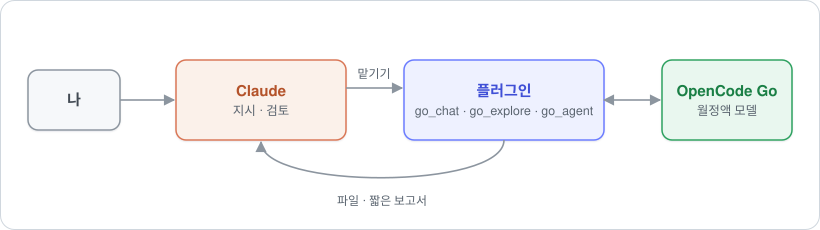
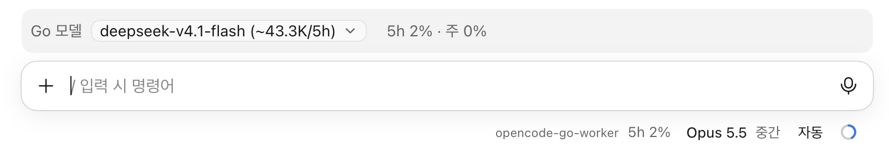
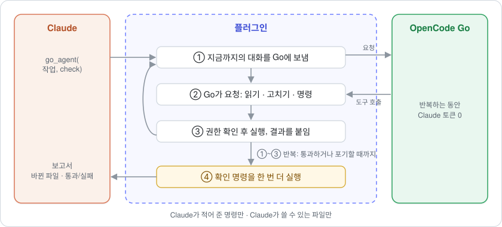

# claude-opencode-go-worker

[English](README.md) · **한국어**

Claude Code에 [OpenCode Go](https://opencode.ai/docs/go)를 일꾼으로 붙이는 플러그인입니다.

> Claude를 바꾸는 도구가 아니라, Claude가 잡일을 맡길 하청을 하나 두는 도구. 판단과 통제는 끝까지 Claude Code 안에 있고, 토큰이 아까운 일만 월정액 모델에 넘긴다.

생각은 Claude가 하고, 손이 많이 가는 일은 Go가 합니다. Go는 월정액이라 한도 안에서는 몇 번을 불러도 추가 비용이 없습니다. 그래서 테스트 수십 개 쓰기, 정해진 형식의 코드 찍어내기, 데이터 변환처럼 길지만 뻔한 일은 Go에 넘기고, Claude는 지시와 검토만 합니다.

Python, Node, 별도 서버, OpenCode CLI 모두 필요 없습니다. Claude Code 안에서 그대로 돌아갑니다.



## 화면



- **프롬프트 위 한 줄**: 지금 쓰는 모델과 이 세션의 사용량입니다. 드롭다운으로 모델을 바로 바꿀 수 있고, 각 모델 옆에는 5시간 동안 보낼 수 있는 대략의 요청 수가 붙습니다. `5h` 숫자는 80%를 넘으면 노란색, 한도에 닿으면 빨간색이 됩니다. 창이 좁으면 덜 중요한 숫자부터 빠집니다.
- **아래 상태줄**: 플랜의 5시간 창을 얼마나 썼는지만 보여 줍니다. 플러그인이 켜져 있다는 표시도 겸합니다.
- 에이전트가 일하는 동안에는 사용량 자리에 `go_agent 3단계 · edit_file duration.py` 같은 진행 상황이 뜹니다.

## 도구

| 도구 | 언제 쓰나 | 돌려주는 것 |
|---|---|---|
| `go_chat` | 길고 명세가 분명한 한 번짜리 작업 | 답 또는 저장한 파일 경로 |
| `go_models` | 쓸 모델이 정해지지 않았을 때 | 모델별 한도, effort 값, 데이터 보관 여부 |
| `go_explore` | "이게 어디 정의돼 있지?" 같은 넓은 코드 탐색 | 답과 `path:line` 근거 |
| `go_agent` | 테스트로 확인할 수 있는 작은 코딩 작업 | 바뀐 파일, 확인 결과, 요약 |

### go_agent는 이렇게 일합니다

Claude는 한 번 부르고 보고서 한 장을 받습니다. 고치고, 테스트하고, 다시 고치는 반복은 전부 플러그인 안에서 Go가 혼자 합니다. 그 사이에 Claude 토큰은 쓰이지 않습니다.



Go가 실행할 수 있는 명령은 Claude가 호출할 때 적어 준 것(최대 5개)뿐입니다. 번호로만 고를 수 있고 내용은 바꿀 수 없습니다. 파일은 Claude가 묻지 않고 읽고 쓸 수 있는 곳만 다룹니다.

## 설치

Claude Code 터미널에서:

```
/plugin install opencode-go-worker --marketplace doongchoong/claude-opencode-go-worker
```

데스크톱 앱에서는 프롬프트 옆 **+** → **Plugins** → **Add marketplace** 에 `doongchoong/claude-opencode-go-worker` 를 넣고 **Add plugin** 을 누릅니다.

설치할 때 OpenCode Console API 키(`oc_sk_…`)를 물어봅니다. Go를 구독한 워크스페이스의 키여야 합니다. 키는 OS 보안 저장소에 들어갑니다. 설정을 비워 두면 `~/.config/opencode-go/api_key` 파일을 읽습니다. 환경 변수는 보지 않습니다.

> Claude 데스크톱 앱의 채팅 탭이나 claude.ai에서는 동작하지 않습니다. Claude Code(터미널, 데스크톱 앱의 Code 탭, IDE 확장)에서만 됩니다.

## 쓰는 법

먼저 모델을 하나 고릅니다. 프롬프트 위 드롭다운이나 `/go-model` 로 고르면 됩니다. 라인업이 자주 바뀌어서 플러그인이 대신 정해 두지 않습니다.

그다음은 평소처럼 Claude에게 말하면 됩니다. 맡길 만한 일은 Claude가 알아서 Go에 넘기고, 직접 시켜도 됩니다.

```
parser.py 단위 테스트를 Go한테 tests/test_parser.py에 쓰게 하고 돌려 봐
이 변환 작업 12개 Go에 병렬로 맡겨
실패하는 테스트 고치는 거 go_agent로 해. 확인은 pytest tests/parser
Go로 이 저장소에서 API 키를 어디서 읽는지 찾아봐
이번 건 pro로 해 줘
```

결과는 Claude가 확인합니다. 테스트를 돌려 보고, 필요한 부분만 읽고, 두 번 시켜도 안 되면 직접 씁니다.

### 모델 고르기

- 고른 모델은 그 세션에만 적용됩니다. 다른 세션은 각자 시작할 때의 모델을 계속 씁니다.
- 고르면 새 세션의 기본값(`default_model`)도 같이 바뀝니다. 이때 플러그인이 한 번 다시 로드되면서 "options changed — reloaded" 줄이 남는데, 정상입니다.
- "pro로 해 줘"처럼 말하면 그 호출에만 다른 모델이 들어갑니다. 드롭다운은 그대로입니다.

드롭다운의 `(~43.3K/5h)` 는 OpenCode 콘솔이 추정한 5시간당 요청 수입니다. 이 숫자를 주는 API가 없어서 콘솔의 공개 페이지에서 읽어 옵니다. 페이지를 못 읽으면 마지막으로 읽은 값을 2주까지 쓰고, 그것도 없으면 API에 있는 월간 한도(`($100/mo)`)를 대신 보여 줍니다. Go Plus인지는 첫 응답을 보고 압니다.

## 설정

| 옵션 | 기본값 | 설명 |
|---|---|---|
| `api_key` | — | Console 키 |
| `default_model` | — | 새 세션이 쓸 모델. 드롭다운이나 `/go-model` 로 고르면 바뀝니다 |
| `explore_agent` | 켜짐 | `go_explore` 사용 |
| `worker_agent` | 켜짐 | `go_agent` 사용 |
| `allow_outside_workdir` | 꺼짐 | `go_chat` 의 파일 권한 확인 건너뛰기 (`go_agent`, `go_explore` 에는 적용 안 됨) |
| `language` | `auto` | 설정, 모델 바, 상태줄, 명령의 언어 (`auto`는 Claude 앱 언어, 없으면 시스템 언어를 따름. `en`, `ko`) |

| 명령 | 하는 일 |
|---|---|
| `/go-model [id]` | 이 세션의 모델 바꾸기. id 없이 치면 고르는 창이 뜹니다 |
| `/go-usage` | 이 세션 사용량과 5시간·주간·월간 한도, 리셋 시각 |

잠시 끄려면 `/plugin disable opencode-go-worker` 를 쓰거나 `~/.config/opencode-go/disabled` 파일을 만듭니다. 파일을 지우면 다시 켜집니다.

## 안전장치

**파일을 망치지 않게**
- 긴 출력이 잘리거나 연결이 끊기면 원래 파일은 그대로 두고 `<파일>.partial` 에 따로 저장합니다.
- 빈 답으로는 파일을 덮어쓰지 않습니다.
- 파일 접근은 Claude Code 권한을 그대로 따릅니다. `Read(.env)` 같은 deny 규칙이 걸린 파일은 절대 보내지 않습니다.

**돈이 새지 않게**
- 요청이 Go 한도가 아니라 잔액에서 빠져나가면 결과에 표시하고, Claude가 더 부르기 전에 묻게 합니다.
- 평일 피크 시간에 한도를 몇 배로 쓰는 모델은, 그 시간에 부르면 결과에 그렇게 적힙니다.

**정보가 새지 않게**
- 키는 `curl` 에 표준 입력으로 넘겨서 프로세스 목록에 나타나지 않습니다.
- 파일 내용은 무작위 id로 감싸서 Go에 보내고, 그 안의 문장은 지시로 따르지 말라고 알려 둡니다.
- 프롬프트와 파일은 OpenCode를 거쳐 모델 제공자에게 갑니다. 프롬프트를 보관하거나 학습에 쓰는 모델은 `go_models` 에 `trains-on-data`, `no-zdr` 로 표시되니, 비밀이 담긴 코드에는 피하세요.

## 알아 둘 점

- 남은 한도(5시간·주간·월간 %)는 문서에 없는 엔드포인트(`/zen/go/v1/usage`)에서 가져옵니다. 응답이 없으면 상태줄에 `5h —` 로 나옵니다.
- 사용률은 1% 단위라 작은 호출 몇 번으로는 숫자가 움직이지 않을 수 있습니다. 정확한 사용량은 `/go-usage` 에서 봅니다.
- `go_agent` 의 명령은 Claude Code Bash 샌드박스 밖에서, 명령마다 5분 제한으로 돕니다. 테스트는 Go가 고친 코드를 실행하므로 결과를 받으면 diff를 한 번 봐 주세요.
- 예전 버전은 explore를 서브에이전트로 돌렸는데, auto 모드에서 안전 검토를 받지 못하고 명령도 막혀서 지금처럼 도구로 바꿨습니다. 자세한 내용은 [spike/FINDINGS.md](spike/FINDINGS.md)에 있습니다.

## 구조

```
.claude-plugin/plugin.json       매니페스트와 옵션
.claude-plugin/marketplace.json  /plugin install 용
hooks/register.tsx               도구, Claude용 안내, 상태줄, 모델 바, 명령
hooks/go.test.ts                 테스트 (claude plugin test .)
types/index.d.ts                 플러그인 상태의 모양
spike/                           API 조사 스크립트와 결과
docs/                            README 그림 (python3 docs/make_diagrams.py docs)
```

배포할 때는 `.claude-plugin/plugin.json` 의 `version` 을 올려야 합니다. 설치본이 버전별로 캐시되기 때문입니다.

## 라이선스

[MIT](LICENSE)
