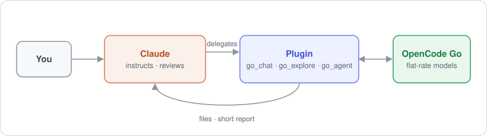
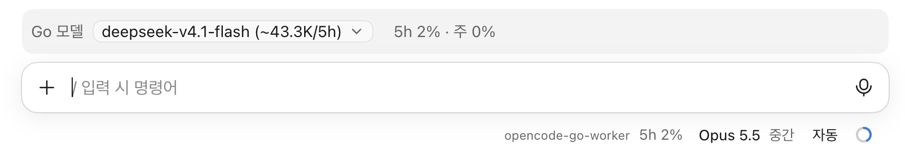
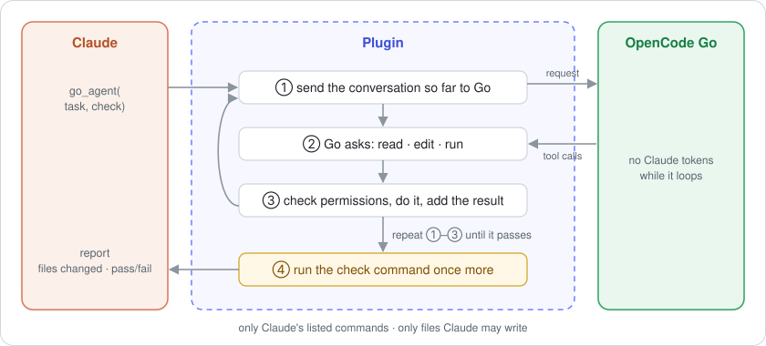

# claude-opencode-go-worker

**English** · [한국어](README.ko.md)

A Claude Code plugin that gives Claude a worker on [OpenCode Go](https://opencode.ai/docs/go).

> Claude stays in charge. This doesn't swap Claude out — it gives Claude a cheap pair of hands for the busywork, while every decision and every permission check stays in Claude Code.

Claude does the thinking; Go does the legwork. Go is a monthly plan, so within its limits a call costs nothing extra. Long but predictable work — dozens of tests, code in a fixed format, data conversion — goes to Go, and Claude only writes the instructions and checks the result.

No Python, Node, server or OpenCode CLI to install. It runs inside Claude Code.



## On screen



- **The bar above the prompt**: the model in use and this session's usage. Switch models in the dropdown; each one shows roughly how many requests fit in 5 hours. The `5h` figure turns yellow past 80% and red at the limit. On a narrow window the less important figures drop out first.
- **The status line**: just how much of the plan's 5-hour window is used — and a sign the plugin is loaded.
- While an agent works, the usage figures give way to its progress, like `go_agent step 3 · edit_file duration.py`.

## Tools

| Tool | When | Returns |
|---|---|---|
| `go_chat` | One well-specified job with a long output | The answer, or the path of the file it wrote |
| `go_models` | No model has been picked yet | Limits, effort values and data-retention flags per model |
| `go_explore` | A broad codebase question — "where is this defined?" | The answer with `path:line` evidence |
| `go_agent` | A small coding task a test can check | Changed files, check verdict, summary |

### How go_agent works

Claude calls it once and gets one report back. Editing, testing and fixing again all happen inside the plugin, with Go on its own — no Claude tokens in between.



Go can run only the commands Claude listed in the call (five at most), picked by number; it can't change them. It reads and writes files only where Claude could without asking.

## Install

In a Claude Code terminal:

```
/plugin install opencode-go-worker --marketplace doongchoong/claude-opencode-go-worker
```

In the desktop app: **+** next to the prompt → **Plugins** → **Add marketplace** with `doongchoong/claude-opencode-go-worker` → **Add plugin**.

It asks for an OpenCode Console API key (`oc_sk_…`) from a workspace subscribed to Go, and keeps it in your OS's secure storage. Leave the option empty and it reads `~/.config/opencode-go/api_key` instead. Environment variables are never read.

> It doesn't run in the Claude desktop app's chat tab or on claude.ai — only in Claude Code (terminal, the desktop app's Code tab, IDE extensions).

## Using it

Pick a model first, in the dropdown or with `/go-model`. The lineup changes often, so the plugin doesn't pick one for you.

Then talk to Claude as usual. It hands suitable work to Go on its own, and you can ask directly:

```
Have Go write unit tests for parser.py into tests/test_parser.py, then run them
Give these 12 conversions to Go in parallel
Use go_agent to fix the failing tests; check with pytest tests/parser
Use Go to find where this repo reads the API key
Do this one with pro
```

Claude checks what comes back — runs the tests, reads the parts that matter — and writes it itself after two failed attempts.

### Picking a model

- A pick applies to that session only. Other sessions keep the model they started with.
- It also becomes the default for new sessions (`default_model`). The plugin reloads once and leaves an "options changed — reloaded" line; that's expected.
- "Do this one with pro" sends just that call to another model; the dropdown stays as it is.

The `(~43.3K/5h)` in the dropdown is the OpenCode console's estimate of requests per 5 hours. No API gives it, so it's read from the console's public page. If the page can't be read, the last good numbers are used for up to two weeks; failing that, the monthly limit from the API shows instead (`($100/mo)`). Whether you're on Go Plus is learned from the first response.

## Settings

| Option | Default | |
|---|---|---|
| `api_key` | — | Console key |
| `default_model` | — | Model for new sessions; the dropdown and `/go-model` set it |
| `explore_agent` | on | Use `go_explore` |
| `worker_agent` | on | Use `go_agent` |
| `allow_outside_workdir` | off | Skip `go_chat`'s file permission checks (never applies to `go_agent` or `go_explore`) |
| `language` | `auto` | Language of the settings, model bar, status line and commands (`auto`, `en`, `ko`) |

| Command | |
|---|---|
| `/go-model [id]` | Switch this session's model; without an id, a picker opens |
| `/go-usage` | This session's usage, and the 5-hour, weekly and monthly windows with reset times |

To turn it off for a while, use `/plugin disable opencode-go-worker` or create `~/.config/opencode-go/disabled`; delete the file to turn it back on.

## Safeguards

**Your files**
- If a long output is cut off or the stream drops, the original file stays as it was and the reply goes to `<file>.partial`.
- An empty reply never overwrites a file.
- File access follows Claude Code's permissions; a file behind a deny rule such as `Read(.env)` is never sent.

**Your money**
- A request billed to your balance instead of the Go allowance is flagged, and Claude asks you before making more.
- Models that use a multiple of the allowance at weekday peak hours say so when called then.
- Past 80% of the 5-hour window, or on a limit error, Claude stops using Go until the reset.

**Your data**
- The key goes to `curl` on standard input, so it never shows in process lists.
- File contents are wrapped in a random-id block, and Go is told not to follow instructions found inside.
- Prompts and files go through OpenCode to the model's provider. Models that may keep or train on prompts are marked `trains-on-data` / `no-zdr` in `go_models`; avoid them for private code.

## Good to know

- The remaining-limit figures come from an undocumented endpoint (`/zen/go/v1/usage`). If it doesn't answer, the status line shows `5h —`.
- Usage is reported in whole percent, so a few small calls may not move it. `/go-usage` has the exact figures.
- `go_agent`'s commands run outside Claude Code's Bash sandbox, five minutes each at most. The check runs code Go just changed, so look at the diff when the report comes back.
- An earlier version ran explore as a subagent; under auto mode its work couldn't be reviewed and its commands were refused, so both agents are tools now. Details in [spike/FINDINGS.md](spike/FINDINGS.md).

## Layout

```
.claude-plugin/plugin.json       manifest and options
.claude-plugin/marketplace.json  for /plugin install
hooks/register.tsx               tools, guidance for Claude, status line, model bar, commands
hooks/go.test.ts                 tests (claude plugin test .)
types/index.d.ts                 the shape of the plugin's state
spike/                           API investigation script and findings
docs/                            README diagrams (python3 docs/make_diagrams.py docs)
```

Bump `version` in `.claude-plugin/plugin.json` with every release; installs are cached per version.

## License

[MIT](LICENSE)
